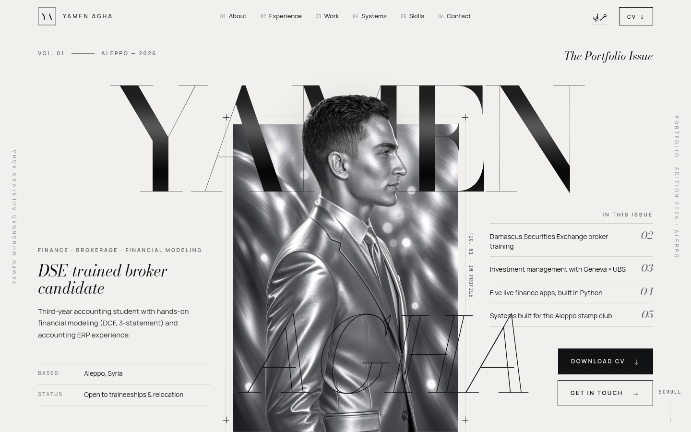
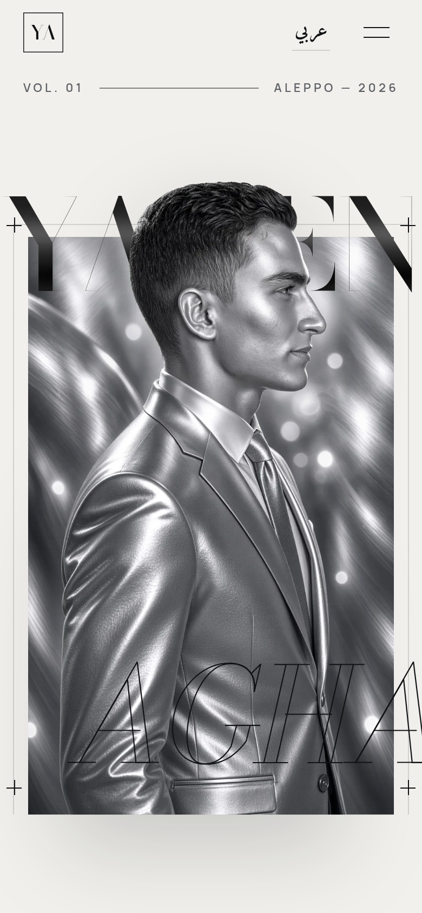
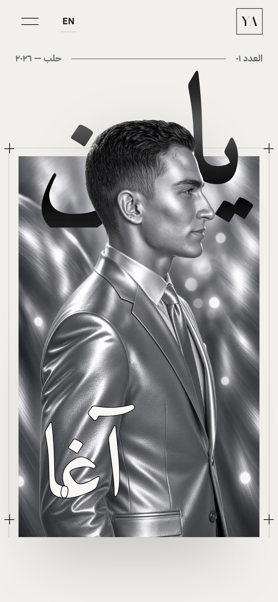
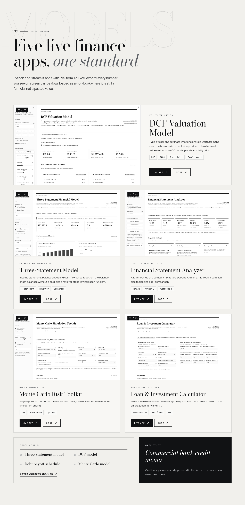

<div align="center">

# Yamen Agha — Portfolio

**Finance · Brokerage · Financial Modeling**
DSE-trained broker candidate and third-year accounting student, Aleppo.

[**yasskik.github.io**](https://yasskik.github.io/) · [النسخة العربية](https://yasskik.github.io/ar/) · [LinkedIn](https://www.linkedin.com/in/yamen-agha-157600288) · [Finance projects](https://github.com/Yasskik/portfolio)



</div>

## The idea

A personal site designed like a fashion-magazine cover in silver. A monochrome portrait sits in a framed plate, and the head breaks out of the frame. The name is layered around the figure: **YAMEN** in brushed-graphite Bodoni sits *behind* the portrait, and **AGHA** in an outlined italic sits *in front* of it. Hairline rules, issue numbers ("Vol. 01 — Aleppo, 2026"), vertical side rails and oversized outlined section words carry the editorial look through the rest of the page.

The content mirrors the latest CV (v2): the DSE broker training, the University of Geneva & UBS specialization, accounting ERP work, the five live finance apps and the systems built for the Aleppo stamp club.

<table>
  <tr>
    <td width="30%"></td>
    <td width="30%"></td>
    <td></td>
  </tr>
</table>

## Features

- **Layered portrait hero.** A clean figure cutout sits over the original plate, so type can pass behind and in front of the subject. Scroll and pointer parallax move each layer at its own speed.
- **Brushed-metal type.** Large display type is clipped to a fine brushed-graphite texture, and the light moves across it as you scroll. No gradients.
- **Two languages.** A full English site and an Arabic (RTL) edition at `/ar/`, built from one template. Arabic uses Amiri and IBM Plex Sans Arabic, and every layout uses logical CSS properties so it mirrors properly.
- **Market-ticker strip.** Real highlights from the CV, such as "70+ scenarios" and "0 execution errors", in ticker style with green and red markers.
- **Work that can be checked.** Every finance app has a **Live app** link and a **Code** link to its folder in [Yasskik/portfolio](https://github.com/Yasskik/portfolio).
- **CV downloads.** English and Arabic PDFs are in `cv/`.
- **Small, careful interactions.** Reveal-on-scroll, magnetic buttons, a soft cursor-follow light on cards, monochrome screenshots that turn to colour on hover, and a section counter.
- **Accessible and fast.** Semantic HTML, a skip link, visible focus, `prefers-reduced-motion` support, self-hosted fonts, WebP images with `srcset`, no framework and about 12 KB of JavaScript.
- **SEO.** Meta description, Open Graph and Twitter cards, `hreflang` alternates, JSON-LD `Person`, sitemap and favicons.

## Tech

| | |
|---|---|
| Markup | Static HTML generated by `build.py` (Python + Jinja2) from one template, `templates/index.html.j2` |
| Styles | Hand-written CSS (`assets/css/style.css`): container-query units for the hero composition, logical properties for RTL |
| Script | Vanilla JS (`assets/js/main.js`): IntersectionObserver reveals, rAF parallax, magnetic buttons |
| Type | Bodoni Moda, Manrope, JetBrains Mono, Amiri, IBM Plex Sans Arabic (self-hosted, SIL OFL) |
| Images | Portrait cutout made with `rembg` (BiRefNet-portrait model), WebP at 640 and 1008 px |
| Hosting | GitHub Pages, from the root of `main` |

## Structure

```
index.html            English page (generated)
ar/index.html         Arabic page (generated)
templates/            Jinja2 template
build.py              content for both languages + build script
assets/css|js|img|fonts
cv/                   CV PDFs (English, Arabic)
previews/             screenshots used in this README
tools/screenshot.py   headless-Chrome screenshots
tools/og.html         source of the social-share image
```

## Run locally

```bash
python3 -m http.server 8000      # then open http://localhost:8000
```

To edit the content, change the dictionaries in `build.py` and rebuild:

```bash
pip install jinja2
python3 build.py
```

To refresh the screenshots:

```bash
pip install playwright pillow
python3 tools/screenshot.py --chrome /usr/bin/google-chrome
```

## License

The code is MIT-licensed. The portrait, the CV documents and the written content belong to Yamen Agha and may not be reused.
